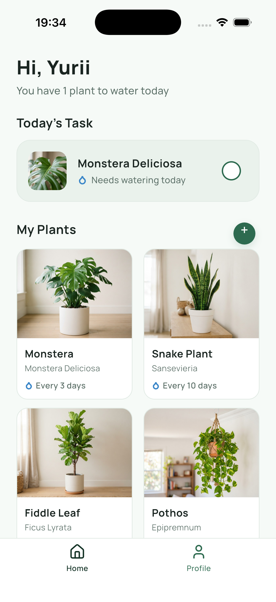
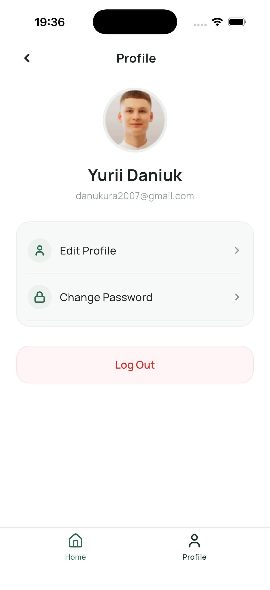

# Sprout screenshot evidence

Captured from the running Flutter app on 2026-10-05 using iOS 26.5 Simulator. These are application screenshots without Simulator window chrome. Device-native safe areas are retained.

| Screen | iPhone 17 Pro | iPhone 17e |
|---|---|---|
| Log In | [01-login.png](iphone17pro/01-login.png) | [01-login.png](iphone17e/01-login.png) |
| Sign Up | [02-signup.png](iphone17pro/02-signup.png) | [02-signup.png](iphone17e/02-signup.png) |
| Forgot Password | [03-forgot-password.png](iphone17pro/03-forgot-password.png) | [03-forgot-password.png](iphone17e/03-forgot-password.png) |
| Home | [04-home.png](iphone17pro/04-home.png) | [04-home.png](iphone17e/04-home.png) |
| Profile | [05-profile.png](iphone17pro/05-profile.png) | [05-profile.png](iphone17e/05-profile.png) |
| Change Password | [06-change-password.png](iphone17pro/06-change-password.png) | [06-change-password.png](iphone17e/06-change-password.png) |

Additional evidence: [full lower grid on 17 Pro](iphone17pro/04-home-grid.png), [full lower grid on 17e](iphone17e/04-home-grid.png), [Sign Up keyboard](iphone17e/02-signup-keyboard.png), [Change Password keyboard](iphone17e/06-change-password-keyboard.png). Home naturally scrolls because native bars occupy more height than the decorative Figma bars.

Home/Profile images use the default Figma identity. Forms are empty in the six primary screenshots. The keyboard screenshots show that primary actions stay reachable. Signup using Alex Green/alex@example.com, task toggling/retention, logout reset, future-feature messages and password demo messages were exercised during simulator inspection and are covered by the 13 widget tests.

## Home preview

The iPhone17e primary Home screenshot was refreshed after correcting the plus glyph's centering. Other screenshots retain the initial implementation capture.

## Profile preview

